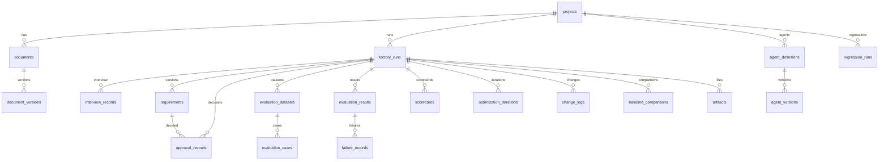

# Database schema

Supabase PostgreSQL stores structured application data; Supabase Storage stores files;
ChromaDB stores vectors. Migrations: `app/database/migrations/` (applied in order
`000` -> `002`).

## Responsibilities

| Store | Holds |
|---|---|
| Supabase Postgres | users/profiles, projects, document metadata and versions, runs, interview, requirements, approvals, agents and versions, datasets, cases, results, failures, scorecards, iterations, change logs, regression runs, baseline comparisons, artifact references, audit logs, tool registry |
| Supabase Storage | bucket `documents` (uploaded files, `<project_id>/<hash>_<name>`), bucket `deliverables` (all run artifacts, `<project_id>/<run_id>/<file>`). Both private. |
| ChromaDB | one collection per project and chunking configuration (`p_<project>_c<size>_o<overlap>`), cosine space; chunk text + metadata (document_id, filename, page/row range, section, content hash) |
| Local disk | `artifacts/runs/<slug>/` copies of every artifact (committed evidence), `data/uploads/<project_id>/` raw files used for re-chunking and the CSV tool |

## Tables (22)

All tables use `uuid` primary keys (`gen_random_uuid()`), `created_at timestamptz`, foreign
keys with `on delete cascade` to their parent, and an index on every foreign key.

| Table | Key columns | Notes |
|---|---|---|
| profiles | id -> auth.users, display_name, role | one row per Supabase Auth user |
| projects | owner_id -> auth.users, name, brief | ownership root for RLS |
| documents | project_id, filename (unique per project), file_type, size_bytes, current_hash, current_version, storage_path, status, metadata jsonb | |
| document_versions | document_id, version, content_hash, chunk_count, change_type (added/modified/removed/unchanged) | regression change detection |
| factory_runs | project_id, status, stages jsonb, stage_messages jsonb, budget jsonb, usage jsonb, stop_reason, final_agent_version | |
| interview_records | run_id, analysis jsonb, questions jsonb | questions and answers |
| requirements | run_id, version, kind (original/edited/approved/rejected), content jsonb, groundability jsonb | every version kept |
| approval_records | run_id, requirements_id, decision, approver_id, approver_label, comment, diff jsonb, decided_at | append-only (trigger) |
| agent_definitions | project_id, run_id, agent_name, latest_version, final_version, origin (forgeai/human_baseline) | |
| agent_versions | agent_definition_id, version, parent_version, definition jsonb, change_summary jsonb | insert blocked by trigger unless the run is approved |
| tool_registry | name (unique), description, input_schema, output_schema, permission, requires_network, enabled | readable by any signed-in user |
| evaluation_datasets | run_id, version, case_count, generation_config, rejected_candidates | |
| evaluation_cases | dataset_id, test_id, category, subtype, question, expected_behavior, expected_sources, expected_facts, must_refuse, difficulty, evidence | |
| evaluation_results | run_id, agent_version, case_id, test_id, iteration, label, passed, metrics, answer, evidence, deterministic_checks, judge | append-only (trigger): results are never replaced |
| failure_records | result_id, run_id, category | six allowed categories |
| scorecards | run_id, iteration, agent_version, label, content jsonb | |
| optimization_iterations | run_id, iteration (unique per run), from/to version, score_before/after, record jsonb, decision | |
| change_logs | run_id, iteration, agent_version, field_path, old_value, new_value, reason | one row per changed field |
| regression_runs | project_id, base_run_id, document_changes, summary, report | |
| baseline_comparisons | run_id, factory_agent_version, baseline_name, results | |
| artifacts | project_id, run_id, kind, filename, storage_path, sha256, size_bytes | |
| audit_logs | actor_id, actor_label, project_id, run_id, action, details | every stage transition, approval and regression |

## Relationships

## Row Level Security

RLS is enabled on every table. `public.owns_project(id)` and `public.owns_run(id)`
(security definer) check `projects.owner_id = auth.uid()`. Project-scoped tables use
`owns_project(project_id)`, run-scoped tables `owns_run(run_id)`, and child tables check
their parent. Storage objects in both buckets are readable only when the first path
segment is a project the user owns.

The FastAPI backend uses the service-role key (server-side only, never sent to the UI)
and additionally checks ownership on every request (`app/api/deps.py: owned_run`).

## Setup

1. Create a Supabase project.
2. Run the three SQL files in `app/database/migrations/` in the SQL editor (skip `000`
   on a fresh project; it only removes an older prototype schema).
3. Put `SUPABASE_URL`, `SUPABASE_ANON_KEY`, `SUPABASE_SERVICE_ROLE_KEY` in `.env`.
