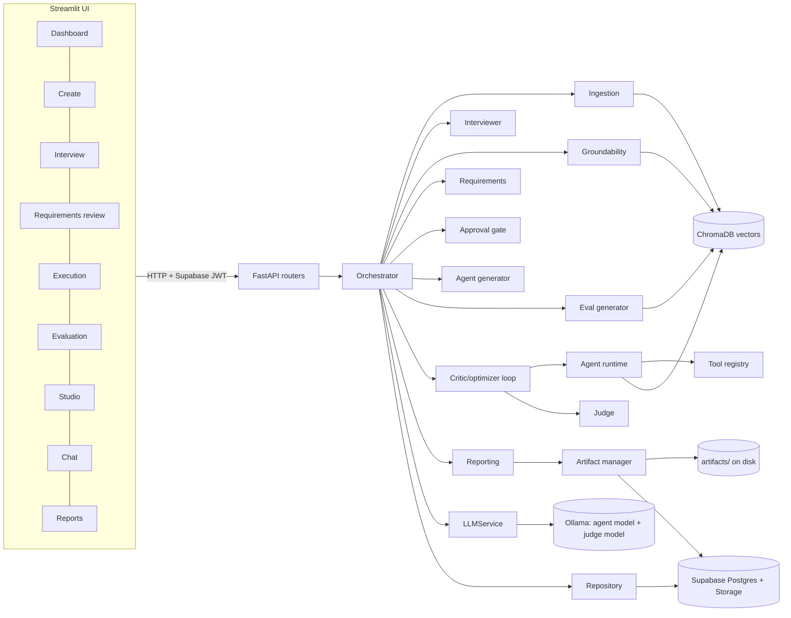
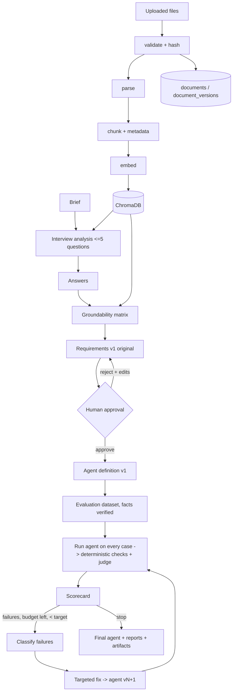

# ForgeAI system architecture

ForgeAI is an *agent engineering factory*: it turns a one-paragraph brief and a folder of
documents into a specialised, document-grounded agent, together with the evidence that
shows how well that agent works. It is not a chatbot; the chat runner at the end is only
the delivery mechanism for the agent the factory built.

## 1. Components (19)

| # | Component | Code | Responsibility |
|---|---|---|---|
| 1 | Intake Interviewer | `app/factory/interviewer.py`, `prompts/interviewer.txt` | Understands purpose, audience and topics; asks at most 5 questions; drops questions the documents already answer (retrieval similarity >= 0.62) and near-duplicates |
| 2 | Document Ingestion Engine | `app/ingestion/*` | Validate (extension, size, magic bytes), parse TXT/PDF/DOCX/CSV, chunk with metadata, embed, store in ChromaDB, record versions in Supabase |
| 3 | Groundability Guard | `app/factory/groundability.py` | Retrieval + per-passage LLM judgement -> supported / partially supported / unsupported / ambiguous matrix |
| 4 | Requirements Manager | `app/factory/requirements_manager.py` | Builds the validated `RequirementsDocument`; deterministic fields never come from the LLM |
| 5 | Human Approval Checkpoint | `app/factory/approval_manager.py` | Edit / approve / reject, diff, history; enforced in code, repository and a DB trigger |
| 6 | Agent Generator | `app/factory/agent_generator.py` | Versioned declarative JSON agent definition; system prompt assembled from LLM-written parts + fixed grounding/citation/refusal/output sections |
| 7 | Tool Registry | `app/tools/*` | csv_lookup, calculator, weather_api (Open-Meteo, allow-listed), current_date |
| 8 | RAG Configuration Engine | `derive_retrieval_config` in `agent_generator.py` | Chunk size / overlap / top-k from measured document statistics |
| 9 | Evaluation Generator | `app/evaluation/eval_generator.py`, `prompts/eval_generator*.txt` | >= 15 cases; every expected fact verified against its source chunk |
| 10 | Agent Runtime | `app/runtime/*` | Generic: loads any valid definition, retrieves, calls only attached tools, validates the output contract |
| 11 | Evaluation Judge | `app/evaluation/evaluator.py`, `deterministic_checks.py`, `llm_judge.py`, `prompts/judge.txt` | Deterministic checks + a separate judge model with verified quotes |
| 12 | Critic and Failure Classifier | `app/evaluation/failure_classifier.py`, `app/optimization/critic.py` | Six failure categories via explicit rules; critic writes general rules, leak-checked |
| 13 | Optimizer | `app/optimization/optimizer.py`, `prompts/optimizer.txt` | Category -> allowed field changes; every change logged |
| 14 | Budget Manager | `app/core/budget_manager.py` | LLM calls, tokens, iterations, time, cases; checked before every call and before every iteration |
| 15 | Regression Engine | `app/regression/regression_engine.py` | Hash-based change detection, re-ingest, re-run old dataset, stale-test detection |
| 16 | Reporting Engine | `app/reporting/report_generator.py`, `pdf_exporter.py` | Honest Markdown/CSV/PDF reports from measured scorecards only |
| 17 | Artifact Manager | `app/reporting/artifact_manager.py` | Every artifact on disk + Supabase Storage + `artifacts` table with SHA-256 |
| 18 | Factory Dashboard | `frontend/Home.py`, `frontend/pages/*` | Streamlit UI (9 pages) |
| 19 | Generic Agent Chat Runner | `frontend/pages/7_Agent_Chat.py`, `app/api/agents.py`, `scripts/run_agent.py` | Chat with any delivered agent; history scoped to one agent |

The orchestrator (`app/core/orchestrator.py`) is the only component that calls the others
in sequence. All hand-offs are Pydantic models in `app/core/schemas.py`.

## 2. Architecture diagram

## 3. Data flow

## 4. Critic–optimizer loop

1. Evaluate version 1 on the full dataset (iteration 0).
2. Stop if the pass rate reaches the target (`QUALITY_TARGET`, default 85%), there are no
   failures, or the budget cannot afford another full evaluation.
3. Pick the two most frequent primary failure categories not yet tried without gain.
4. Apply only the changes mapped to those categories (`prompts/optimizer.txt`).
5. Re-evaluate the **whole** dataset (regressions become visible), compare with the best
   version so far, and record an `IterationRecord` with measured before/after numbers,
   changes, reasons, affected tests and newly passing/failing tests.
6. Keep the best version (pass rate, then composite) and continue from it; stop when there
   is no measurable improvement (< 1 point and no composite gain) or after 3 iterations.

## 5. Model usage and bias controls

* Agent and factory model: `LLM_MODEL` (default `qwen2.5:3b`). Judge: `JUDGE_MODEL`
  (default `llama3.2:3b`), a different model family to reduce self-preference.
* Evaluation runs answers first and judgements second, so the GPU swaps models once
  per evaluation instead of once per case.
* All JSON is validated with Pydantic; invalid replies are retried with the validation
  error (up to `LLM_MAX_RETRIES`).

## 6. Deployment architecture (as built)

Single machine: Ollama (GPU), FastAPI (`uvicorn app.main:app`, port 8000), Streamlit
(`streamlit run frontend/Home.py`, port 8501), ChromaDB persistent directory
(`data/chroma`), and a hosted Supabase project for Postgres, Auth and Storage. The API is
the only component holding the service-role key; the UI holds only the anon key and the
user's session token.
