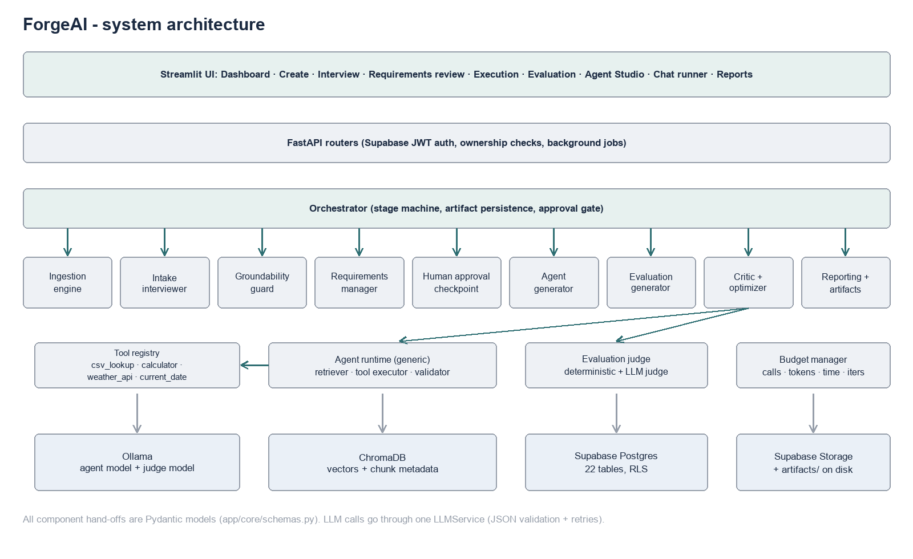
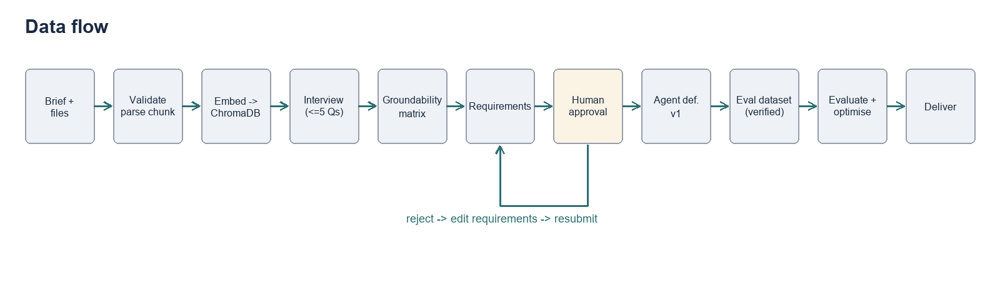
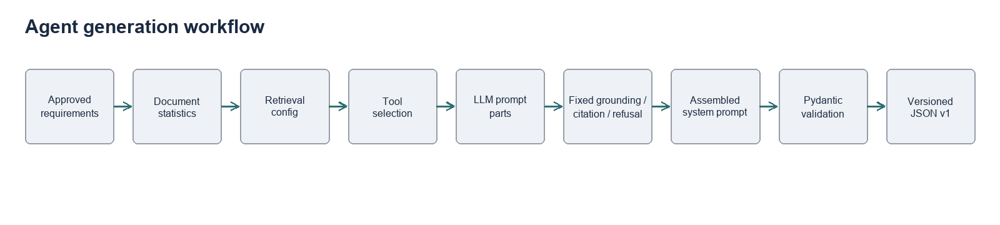
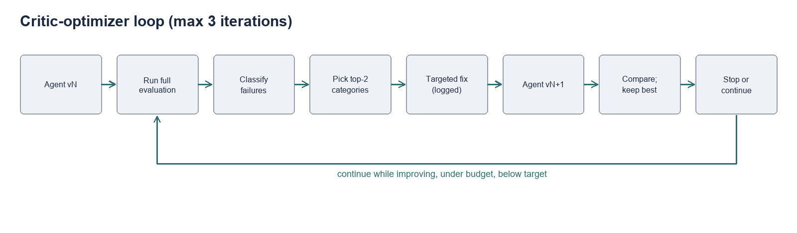

# ForgeAI: The Agent That Builds Agents

Final project report. OceanAI Junior GenAI Engineer campus assignment.

All numbers in this report are read from the committed run artifacts
(`artifacts/runs/`) by `scripts/build_final_report.py`; none were typed by hand.

\pagebreak

## Chapter 1: Introduction

**What ForgeAI is.** ForgeAI is an agent engineering factory. It takes a one-paragraph
brief and a folder of documents and produces a specialised, document-grounded AI agent
together with evidence of how well that agent works: a requirements document approved by
a person, a groundability matrix, a versioned agent definition, an automatically generated
and verified evaluation dataset, scorecards for every optimisation iteration, a change log
and an honest final report.

**Why it is needed.** Building a trustworthy domain assistant is mostly engineering work
around the model: deciding what it should and should not answer, connecting the right
documents, choosing tools, writing tests, finding out why it fails and fixing it. That work
is slow, manual and rarely documented, and the resulting assistants often answer
confidently about things their documents never covered.

**The problem it solves.** ForgeAI turns that work into a repeatable pipeline that works
for briefs and documents it has never seen, and refuses to claim success without measured
evidence.

**Objectives.** Accept an arbitrary brief and document folder; ask at most five questions;
detect unsupported requirements before building anything; require human approval; generate
the agent, its retrieval configuration and its tools; generate at least 15 verified test
cases; evaluate with deterministic checks and an LLM judge; classify failures and fix them
in at most three iterations under a budget; deliver a runnable agent and honest reports.

**Scope.** Document-grounded question-answering agents over TXT, PDF, DOCX and CSV
sources, with a controlled set of four tools, running on local open-weight models.

## Chapter 2: Existing problem

Traditionally an engineer builds such an assistant by hand:

1. writes a system prompt from the stakeholder's description;
2. connects a knowledge base (chunking, embeddings, retrieval settings chosen by habit);
3. attaches tools, often more than needed;
4. writes a handful of test questions, usually ones they expect to work;
5. tries the assistant manually and judges answers by reading them;
6. edits the prompt when something looks wrong.

Limitations: unsupported topics are discovered only when users ask about them; test sets
are small and biased towards success; there is no record of why a change was made or
whether it broke something else; quality claims are anecdotal; and the work has to be
repeated from scratch for every new assistant.

## Chapter 3: Proposed system

ForgeAI automates the whole lifecycle while keeping a person in charge of the decision
that matters most, what the agent is supposed to do:

Document analysis -> interview -> groundability -> **human approval** -> agent generation ->
evaluation generation -> evaluation -> optimisation (at most 3 iterations) -> delivery.

The factory never hardcodes a domain: capabilities come from the brief, the documents, the
tool registry and general-purpose prompts. Small models are not trusted blindly: every
LLM output is schema-validated and retried, and every decision that can be made
deterministically (supported topics, must-refuse topics, fact verification, pass/fail
rules, failure categories, allowed optimisation changes) is made by code.

## Chapter 4: Architecture

The system has 19 components (table in `SYSTEM_ARCHITECTURE.md`). The orchestrator calls
them in sequence; all hand-offs are Pydantic models. The FastAPI backend exposes nine
routers; the Streamlit UI calls only the API.

**Data flow**

**Agent generation workflow**

**Critic–optimizer loop**

**Deployment architecture.** One machine runs Ollama (GPU), the FastAPI server, the
Streamlit UI and a persistent ChromaDB directory. A hosted Supabase project provides
PostgreSQL (22 tables with Row Level Security), Auth and Storage. Only the API process
holds the service-role key.

\pagebreak

## Chapter 5: Technologies

| Technology | Used for | Why |
|---|---|---|
| Python 3.14 | everything | assignment requirement; one language for factory, API, UI and tests |
| FastAPI | REST API | typed endpoints, automatic OpenAPI docs, simple dependency injection for auth |
| Pydantic v2 | every data contract | validation of LLM output and of every hand-off between components |
| Streamlit | UI | a clean, data-centric interface in Python without a separate frontend stack |
| Ollama | local inference | runs open-weight models locally; JSON-schema structured output; no API cost |
| qwen2.5:3b | agent + factory model | strong instruction following and JSON for its size; fits a 4 GB GPU |
| llama3.2:3b | judge model | a different model family from the agent, to reduce self-preference bias |
| sentence-transformers (all-MiniLM-L6-v2) | embeddings | small, fast, good semantic retrieval quality; ONNX Runtime fallback |
| ChromaDB | vector store | embedded, persistent, metadata filters, no extra server |
| PyMuPDF / python-docx / pandas | parsing | page-aware PDF text, DOCX headings and tables, CSV with column names |
| Supabase | Postgres, Auth, Storage | managed database with Row Level Security, authentication and file storage in one place |
| ReportLab | PDF reports | deterministic PDF generation from the same Markdown as the reports |
| pytest | tests | unit, integration and live end-to-end tests |

## Chapter 6: Implementation

**Interviewer.** Reads the brief and an inventory of the documents (names, types, page and
row counts, CSV columns, text previews) and returns purpose, audience, topics, ambiguities
and at most five questions. Questions the documents already answer (high retrieval
similarity) and near-duplicates are dropped and logged.

**Document ingestion.** Files are validated (type, size, real PDF/DOCX signature, readable
text), parsed per type, split into chunks that keep the file name, page or CSV row range
and section, embedded and stored in ChromaDB. Identical files are de-duplicated; changed
files get a new version (content hash) and their old chunks are replaced.

**Groundability.** For each requested topic the guard retrieves passages and asks the LLM,
passage by passage, whether it contains concrete facts about the topic. Code turns those
answers into supported / partially supported / ambiguous / unsupported. Unsupported topics
become must-refuse topics and limitations before any agent exists.

**Approval checkpoint.** The requirements are shown in full and can be edited, approved or
rejected. Every decision stores the approver, time, comment and a field-level diff. Agent
generation is blocked in the orchestrator, in the repository and by a database trigger
until an approval exists.

**Agent generator.** Produces a versioned JSON definition: purpose, audience, tone, system
prompt, knowledge sources, retrieval configuration (derived from document statistics),
tools, output contract, refusal policy, limitations and evaluation requirements. The
grounding, citation, refusal and output-format parts of the prompt are fixed templates;
the LLM writes identity, boundaries, ambiguity and style rules.

**Tool registry.** Four independent tools with input/output schemas, error handling and
availability rules: CSV lookup (with row references), a deterministic calculator, the
Open-Meteo weather API (allow-listed URLs, timeout, validated output) and the current date
(timezone-aware). The factory attaches a tool only when the requirements need it; the
runtime can call only attached tools.

**Evaluation generator.** Generates answerable (single- and multi-document), out-of-scope
and edge cases (false premise, ambiguous, incomplete, paraphrased, partial information).
Every expected fact must be found in its source chunk, otherwise the case is rejected and
the rejection is kept.

**Runtime.** A single generic runtime loads any valid definition, retrieves evidence,
runs attached tools, refuses when there is no evidence, generates a JSON answer and
validates it (fields, citations that really were retrieved, refusal reason, length,
optionally numbers that must appear in the evidence).

**Judge.** Deterministic checks (refusal, expected facts and numbers, unsupported numbers,
citations, contract) are combined with a separate judge model that must quote the
evidence it relies on. An answer cannot pass on the judge's opinion alone.

**Optimizer.** Failures are classified into six categories by explicit rules. Each
iteration fixes the two most frequent categories, changing only the fields mapped to them,
logs every change with its reason, re-runs the whole dataset and keeps the best version.

**Reporting.** Reports are generated from measured scorecards only and separate the case
pass rate, the individual metrics and the derived composite score.

**Regression.** When documents change, ForgeAI detects added/modified/removed files by
hash, re-indexes only those, re-runs the old dataset and separates real regressions from
tests whose facts are no longer in the documents.

## Chapter 7: Database

Supabase PostgreSQL stores 22 normalised tables (profiles, projects, documents,
document_versions, factory_runs, interview_records, requirements, approval_records,
agent_definitions, agent_versions, tool_registry, evaluation_datasets, evaluation_cases,
evaluation_results, failure_records, scorecards, optimization_iterations, change_logs,
regression_runs, baseline_comparisons, artifacts, audit_logs) with UUID keys, foreign keys,
timestamps, JSONB artifacts and indexes. Row Level Security limits every row to the owner
of its project. Supabase Storage holds uploaded documents and every generated deliverable
in two private buckets. ChromaDB holds the vectors, one collection per project and
chunking configuration. Details: `DATABASE_SCHEMA.md`.

\pagebreak

## Chapter 8: Demonstrations

Two deliberately different demonstrations were run through the same factory code with no
code changes between them:

* **HR policy assistant**: three synthetic policy PDFs for a fictional ship-management
  company. Salary and benefits are deliberately absent.
* **Ship-spares procurement assistant**: a 40-row spare-parts catalogue (CSV) and two
  fictional supplier PDFs with overlapping parts and different commercial terms; no
  delivery guarantees anywhere.

The documents were written from committed synthesis prompts (`prompts/dataset_synthesis/`).
In addition, the live test `tests/evaluation/test_live_factory.py` runs the factory on a
third, unseen corpus (a fictional public library, TXT + DOCX) to demonstrate that nothing
is specific to the two demos.

## Chapter 9: Evaluation and results

{{HR_RESULTS}}

{{PROC_RESULTS}}

### Factory vs manual baseline (HR)

{{BASELINE_RESULTS}}

### Regression after a document change (HR)

{{REGRESSION_RESULTS}}

## Chapter 10: Limitations

* The agent, the factory and the judge are 3-billion-parameter local models. They follow
  complex instructions imperfectly; ForgeAI compensates with deterministic rules, but
  individual answers and judgements can still be wrong.
* The evaluation dataset is generated from the same documents the agent uses. It measures
  behaviour on that dataset, not general correctness, and some generated questions are
  imperfect even when their expected facts are verified.
* The pass rate depends on the strictness of the pass rules; it should be read together
  with the individual metrics and the failed-case list.
* Groundability is checked for the topics named in the brief and interview; other
  unsupported questions are handled at answer time by the evidence threshold and refusal
  policy.
* Scanned PDFs (no text layer) are rejected; there is no OCR.
* Background jobs run inside the API process; a production deployment needs a job queue.

## Chapter 11: Future scope

* Larger or hosted models through the existing `LLMService` provider interface, and a
  stronger judge model or a panel of judges.
* Hybrid retrieval (BM25 + vectors), re-ranking and query rewriting as optimizer actions.
* More tools (SQL lookup, document search across projects, ticketing) with the same
  registry contract.
* Human-in-the-loop review of generated test cases and of judge disagreements.
* Distributed execution of evaluations, a job queue and multi-tenant deployment.
* Continuous regression on a schedule when documents change.

## Chapter 12: Conclusion

ForgeAI shows that the engineering around a domain assistant (scoping, grounding checks,
approval, configuration, testing, diagnosis and improvement) can be automated for unseen
briefs and documents, and that the result can be reported honestly. Its main contribution
is not a single good agent but a repeatable, auditable process that states what an agent
can and cannot do, measures it, and keeps the evidence.
